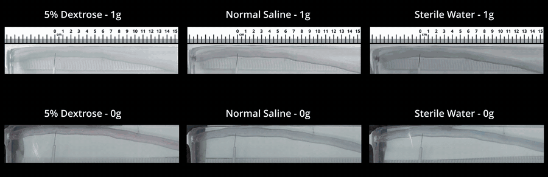
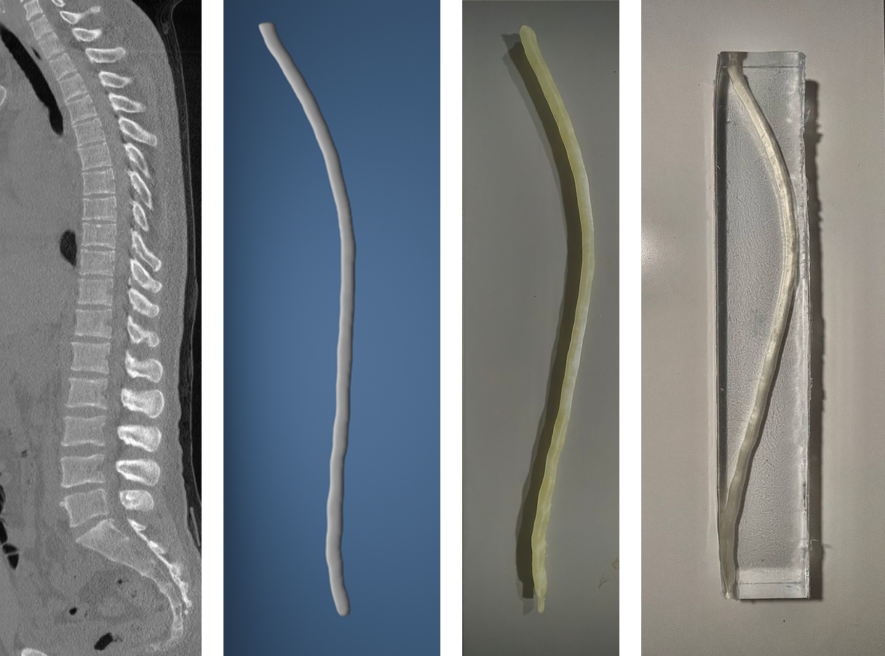
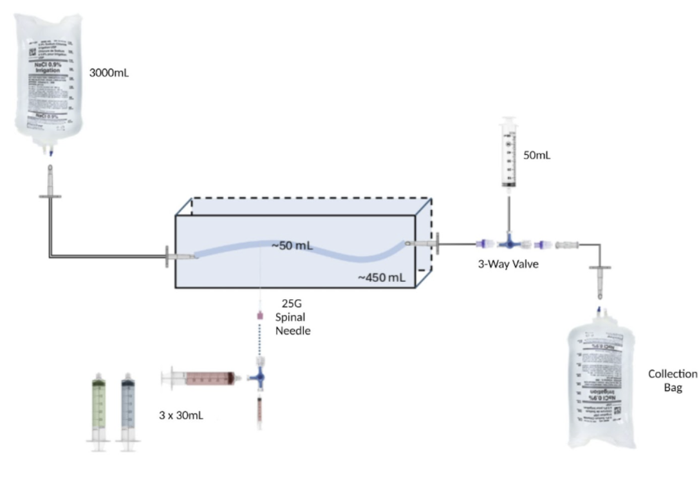
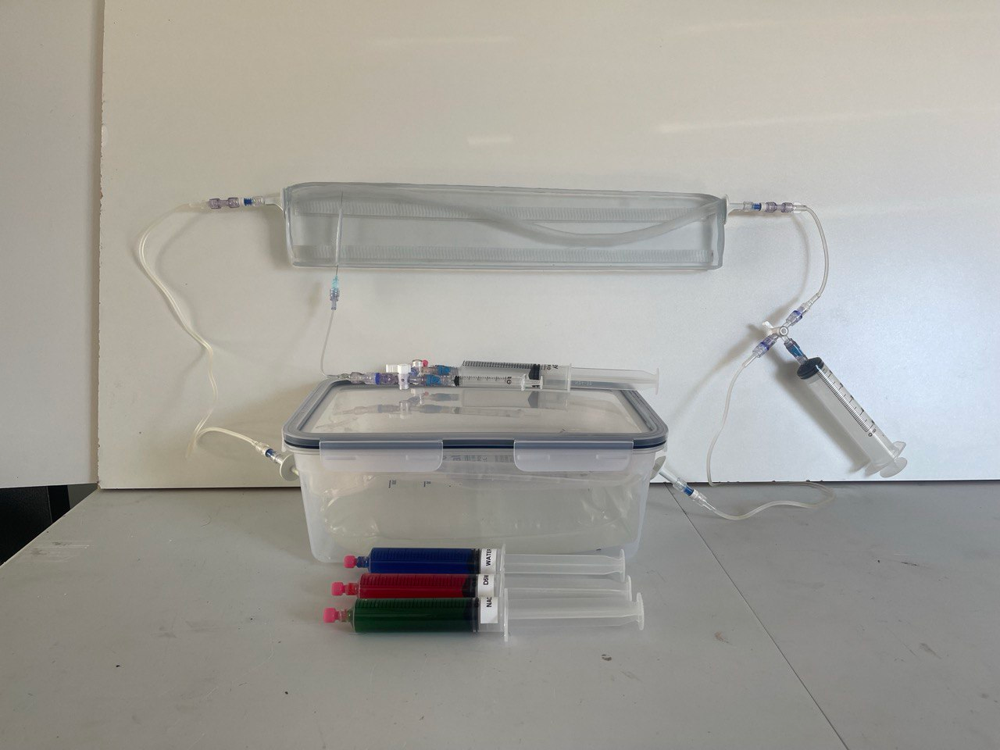
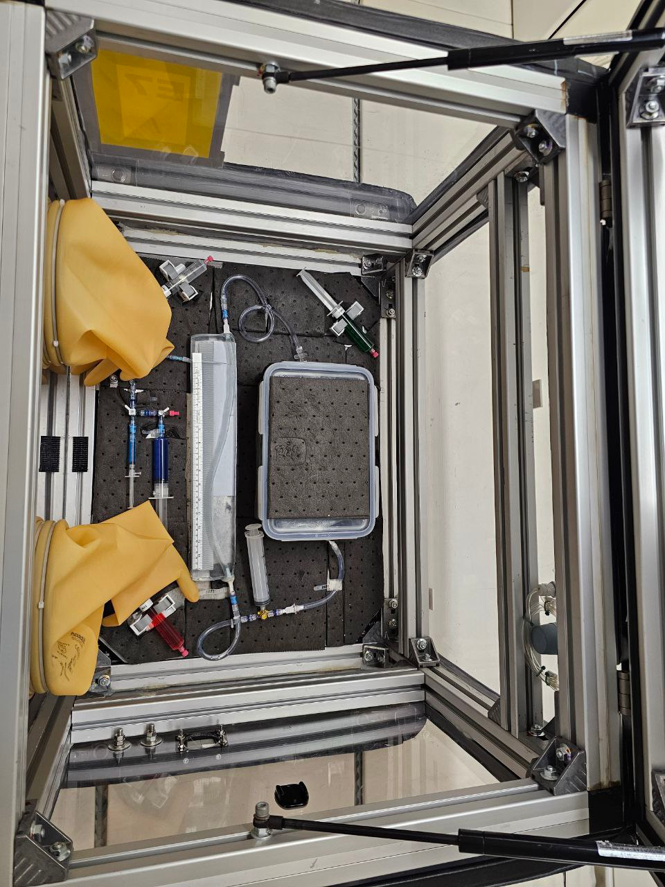
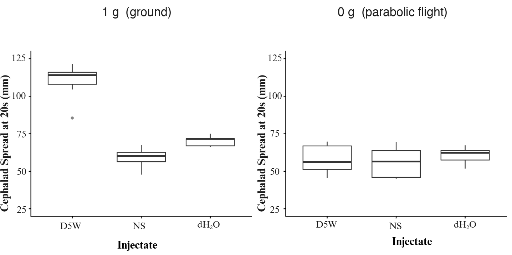

# Spinal anesthesia in microgravity

**A transparent spinal canal model built from CT, tested on the ground and on ESA parabolic flights**

Adrian Tabari, Alexander Suen, Siobhan Wagner, Matthew Turnock (principal investigator)<br>
UBC Faculty of Medicine and Royal Columbian Hospital · 2024 to present



*The same canal model, the same 2 mL injection. Top row: normal gravity. Bottom row: microgravity on the Airbus A310 Zero-G. Red is 5% dextrose (heavier than the saline "CSF"), green is normal saline (same density), blue is distilled water (lighter). On the ground the heavy red solution keeps travelling along the canal; in microgravity all three stop at about the same distance.*

---

## Why this question

Long missions beyond low Earth orbit will eventually need surgery or procedures done in flight, without the option of evacuating the patient. Spinal anesthesia needs less equipment than a general anesthetic, leaves the airway alone and puts no anesthetic gas into a closed cabin. But on Earth, anesthetists steer how high a spinal block goes partly by gravity: a solution denser than cerebrospinal fluid sinks, a lighter one rises. Nobody had tested what happens to that effect without gravity.

## What I did

The project had two parts, each written up as a first-author paper.

### 1. Building a spinal canal you can see through · [details](docs/1_canal_model.md)

<p align="center"></p>
<p align="center"><sub>CT (VerSe) → canal traced in 3D Slicer → PVA print → hollow epoxy cast</sub></p>

I segmented the spinal canal (C3 to L5) by hand from an open CT dataset in 3D Slicer and cleaned the mesh in Blender. Dr. Alex Suen printed it in water-soluble PVA after several rounds of print testing. I cast the print in clear epoxy and dissolved the core out, leaving a hollow, transparent, anatomically shaped canal 44 cm long, with a 25-gauge spinal needle fixed in the lower lumbar region. It sits in a closed saline circuit that can be flushed and reset between injections.

On the bench, 30 injections (10 per solution) were filmed and measured by four blinded reviewers. The model held up (no leaks, cracks or clouding) and clearly separated the solutions over time: at 20 s, about 111 mm of spread for the heavy solution against 60–70 mm for the other two.

The geometry is in [`model/`](model/). GitHub will show it in 3D.

### 2. Flying it on parabolic flights · [details](docs/2_parabolic_flight.md)

| Closed circuit | Ground rig | Flight rack |
|---|---|---|
|  |  |  |

We took the model on the European Space Agency / Novespace parabolic flight campaign VP186 (Bordeaux, 2025): three flight days, 30 parabolas a day, each giving 22–25 s of weightlessness, one injection per parabola. I flew as an experimenter.



**Result.** On the ground the solutions separated by density, as expected. In microgravity they didn't: all three moved a few millimetres between 5 and 10 s and then stopped, ending within about 56–62 mm of the needle, indistinguishable from plain saline on the ground. The most likely reading is that without gravity the only thing moving the drug early on is the push of the injection itself.

**What it suggests.** In weightlessness a heavy or light spinal anesthetic probably won't spread the way it does on Earth. Spread might be more predictable, but the anesthetist loses one of the main ways of controlling how high the block goes. This is a rigid bench model watched for 20 s. It says nothing yet about real patients or the 10–20 minutes over which a block actually develops.

## Outputs

**Papers (first author)**

| | |
|---|---|
| *Intrathecal drug distribution in microgravity: a parabolic flight study.* | **British Journal of Anaesthesia**, accepted 2026 |
| *An epoxy-based spinal canal model for the simulation of intrathecal injectate spread.* | **Canadian Journal of Anesthesia**, accepted 2026 |

Links will be added when the papers are published.

**Talks and poster (presenting author)**

The slides and poster show the analysis as it stood when presented; the papers have the final numbers.

| | |
|---|---|
| *Investigation of spinal anesthesia dynamics in simulated microgravity.* 76th International Astronautical Congress, Sydney, Oct 2025 (oral). [doi:10.52202/083074-0011](https://doi.org/10.52202/083074-0011) | [abstract](abstracts/IAC2025_abstract_spinal_anesthesia_dynamics_microgravity.pdf) · [slides](presentations/IAC2025_talk_slides.pdf) |
| *A 3D-printed, closed-system spinal canal model for the study of anesthetic dynamics.* ANESTHESIOLOGY 2025 (American Society of Anesthesiologists), San Antonio, Oct 2025 (oral) | |
| *Loss of baricity-dependent spread of spinal anesthetic analogues in microgravity.* Canadian Space Conference, Ottawa, Jan 2026 (poster) | [poster](presentations/CSC2026_poster_loss_of_baricity_dependent_spread.pdf) · [abstract](abstracts/CSC2026_abstract_loss_of_baricity_dependent_spread.pdf) |

## My part

From CT to finished model: segmentation, mesh design, epoxy casting and model construction; co-building the fluid circuit; collecting the ground data; flying the experiment; curating the data and doing the statistical analysis (linear mixed-effects models in R); making the figures; drafting both manuscripts; and giving the talks and poster.

Things I'd do differently, most of which the papers say outright: use a syringe pump instead of a hand injection, randomize the order of solutions, measure temperature and density on the day, and track the dye front automatically rather than by eye. About half the flight injections were unusable because air bubbles hid the dye front; we excluded those and reported it.

## Team and support

Dr. Matthew Turnock (PI and corresponding author), Dr. Alexander Suen and Dr. Siobhan Wagner. Supported by the Canadian Space Agency (25HLSHANA4, plus two student conference travel grants), the European Space Agency and Novespace (campaign VP186_87ESA), the Royal Columbian Hospital Foundation Anesthesia Innovation Fund, the Society for Technology in Anesthesia, and the UBC Faculty of Medicine Summer Student Research Program.

A separate computational (CFD) study grew out of this experiment and isn't included here.

## Repository

```
model/           canal geometry (STL) and how it was made
docs/            fuller write-ups of the two studies
figures/         model development, apparatus and result plots
media/           1 g vs 0 g comparison video (MP4) and GIF
presentations/   IAC 2025 slides, CSC 2026 poster
abstracts/       IAC 2025 and CSC 2026 abstracts
```

See [LICENSE.md](LICENSE.md). The geometry is CC BY-SA 4.0, following the CT dataset it came from; everything else is © the authors.
