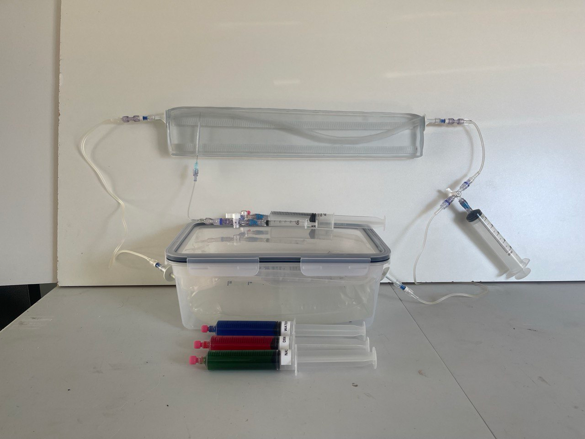
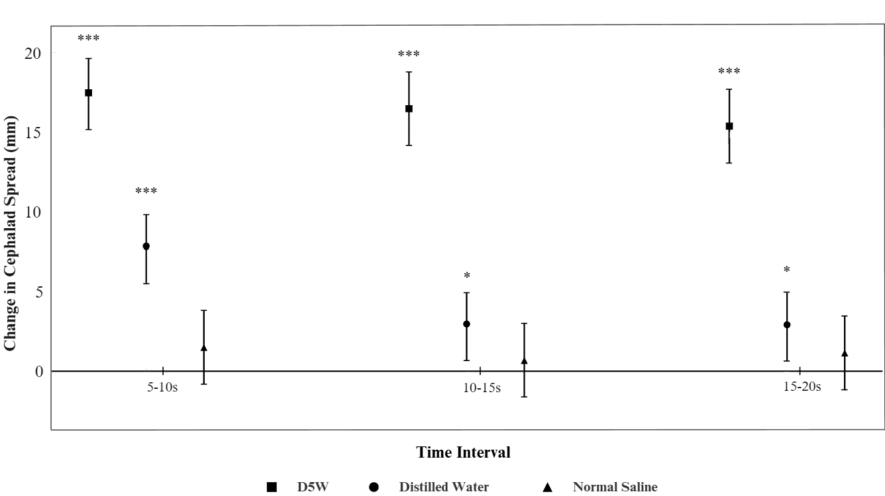

# 1. The canal model and bench study

Summary of: Tabari A, Suen A, Wagner S, Turnock M. *An epoxy-based spinal canal model for the simulation of intrathecal injectate spread.* Canadian Journal of Anesthesia, accepted 2026. First presented at ANESTHESIOLOGY 2025, San Antonio.

[← back to overview](../README.md)

## The gap

Teaching about how spinal anesthetics spread usually relies on diagrams or glass spine models. Glass models show density-driven movement, but they're fragile, anatomically simplified, and sensitive to temperature. Lab models of CSF flow often use straight tubing. We wanted a model that is transparent, durable, reusable and shaped like a real canal.

## Building it

| Step | What was done |
|---|---|
| Source scan | CT of a 27-year-old from the open VerSe dataset, chosen for continuous coverage and no major spinal disease |
| Segmentation | Canal traced by hand from C3 to L5 in 3D Slicer 5.6.2, in axial and sagittal planes |
| Mesh | Cleaned and smoothed in Blender 4.1; end pegs added for anchoring. 44.3 cm long, about 42 mL |
| Print | Several rounds of testing (clear filament wasn't clear enough; an early version had to be printed in two halves). Final core printed in one piece in water-soluble PVA on a Prusa XL, 0.2 mm layers, 15% grid infill, sanded |
| Cast | Core set in a polyethylene mould and covered in clear epoxy, cured 48 h at 22 °C, then the PVA dissolved out in a 30 °C water bath over 24 h. Surface finished with oil for clarity |
| Needle | 25-gauge 3.5-inch Quincke spinal needle at about L3–4, tip 3 mm into the lumen, bevel facing up the canal, glued in place |
| Circuit | Saline bag → one-way valve → canal → one-way valve → three-way stopcock → 50 mL flush syringe and collection bag. Closed during each observation |

## The bench test

- Three dyed solutions expected to be heavier than, equal to and lighter than the saline in the canal: 5% dextrose (red), 0.9% saline (green), distilled water (blue).
- 30 injections, 10 per solution, 2 mL over 2 s by hand, 50 mL saline flush between trials.
- Filmed at 60 fps. Distance up the canal from the needle tip measured against a calibrated ruler at 5, 10, 15 and 20 s.
- Four reviewers measured independently, on grayscale video with no clue to which solution it was (480 measurements, none excluded).
- Analysis in R: linear mixed-effects model (solution × time, random intercept and slope per trial), Holm-adjusted contrasts, reviewer agreement by intraclass correlation, and sensitivity analyses at the reviewer level and with GEE.

## What it showed

- **The model worked as a tool.** It kept the canal's curves, was clear enough to watch the dye in real time, and showed no leaks, cracks, blockage, clouding or dye staining across all 30 trials.
- **It separated the solutions.** Solution, time and their interaction were all significant (P < 0.001). Estimated spread at 20 s: dextrose 111 mm (95% CI 106–116), distilled water 70 mm (66–75), saline 60 mm (55–64).
- **Reviewers agreed closely**, best for the red dextrose (ICC 0.99) and least for saline (0.79–0.84).

## What it doesn't show

This was a test of whether the model can show differences, not a claim that it reproduces a patient. It's rigid, with no dura, nerve roots or CSF pulsation. The solutions' density and temperature weren't measured on the day. The solutions were run in fixed blocks, so order can't be separated from solution. The dye front wasn't defined in advance for reviewers, and the ruler measures straight-line distance rather than distance along the curve. Whether it helps people learn is a separate study.

## Why it mattered next

Because the circuit is closed and stayed leak-free, the same model could go on an aircraft. See [part 2](2_parabolic_flight.md).
