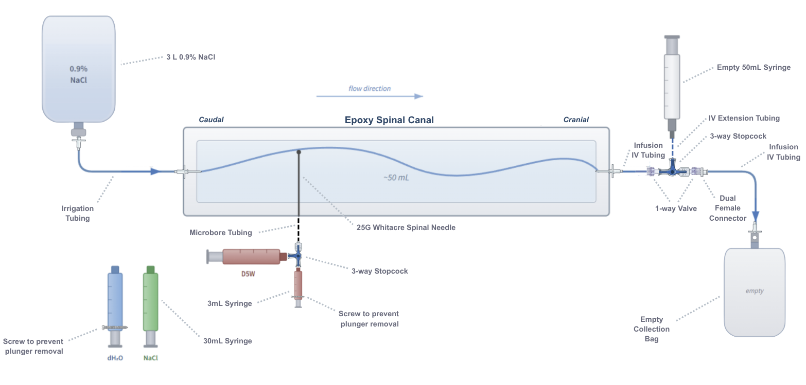
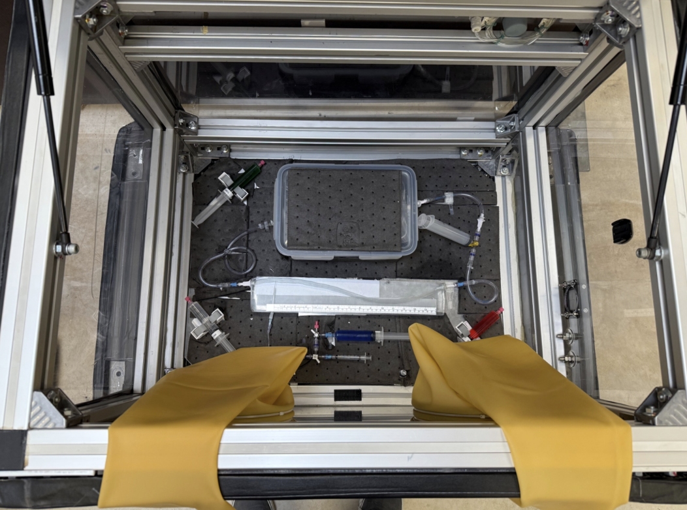
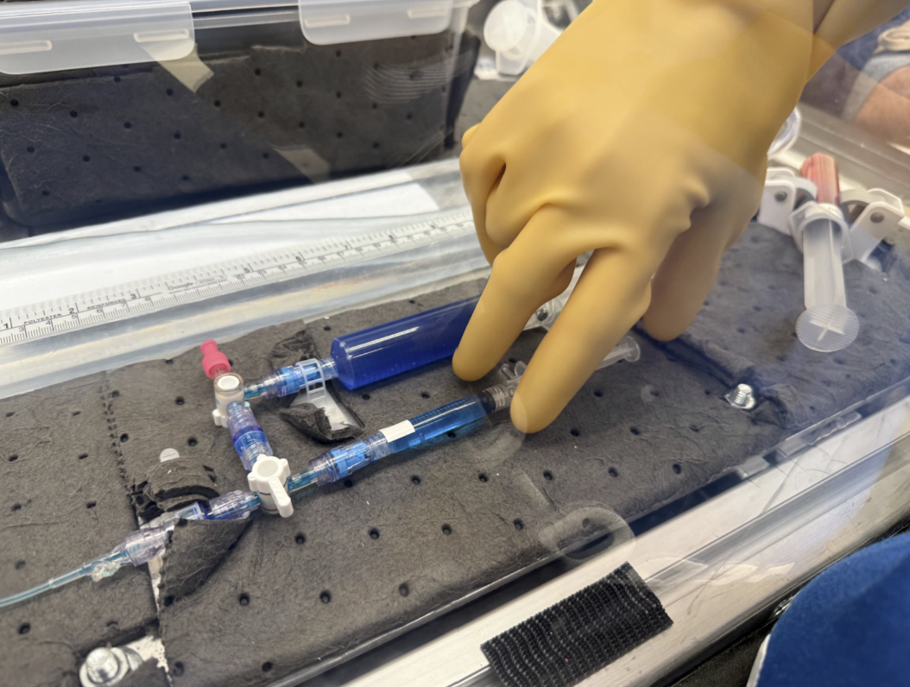
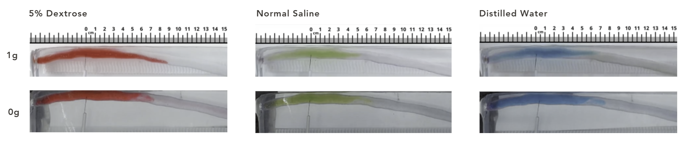
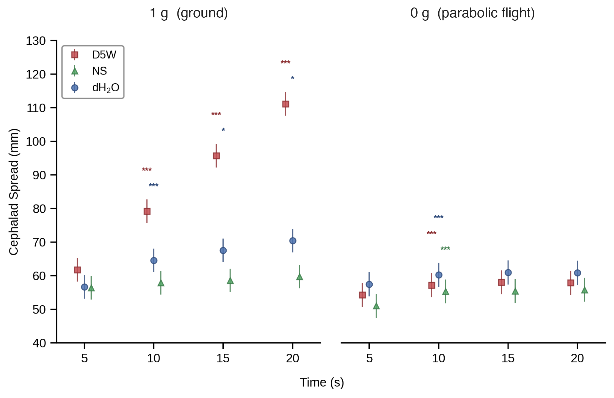
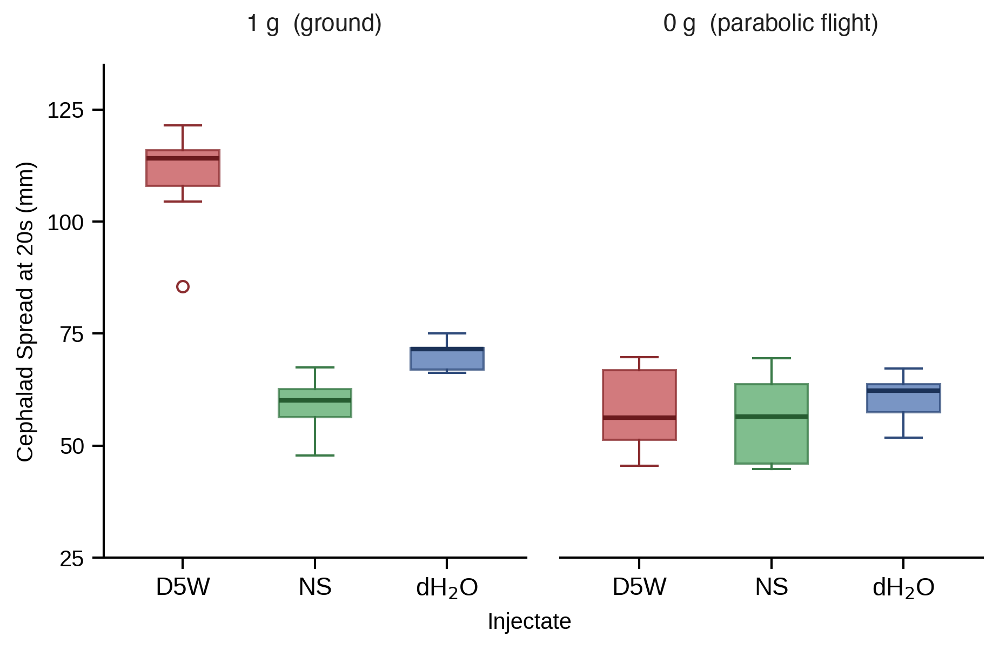
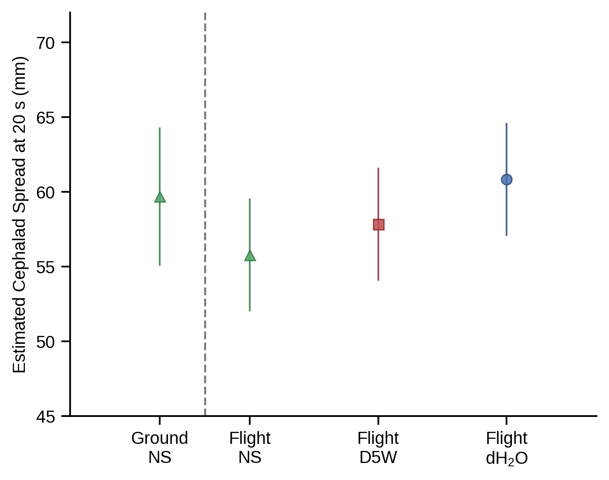

# 2. The parabolic flight study

Summary of: Tabari A, Suen A, Wagner S, Turnock M. *Intrathecal drug distribution in microgravity: a parabolic flight study.* British Journal of Anaesthesia, accepted 2026. Preliminary results: IAC 2025, Sydney ([doi:10.52202/083074-0011](https://doi.org/10.52202/083074-0011)); Canadian Space Conference 2026, Ottawa.

[← back to overview](../README.md)

## Question and hypothesis

Does taking gravity away remove the density-driven separation of spinal injectates? We expected clear separation at 1 g and, in microgravity, all three solutions behaving like a solution of the same density as CSF.

As far as we know this is the first experiment on intrathecal injectate spread in real microgravity.

## Setup

- **Model:** the epoxy canal from [part 1](1_canal_model.md), held horizontally inside a transparent glovebox on a vibration-damped mount, 25-gauge needle at L4, 3 L saline reservoir as the CSF stand-in.
- **Solutions:** 5% dextrose (red, 1.018 g/mL at 20 °C), 0.9% saline (green, 1.005) and distilled water (blue, 0.998), against saline at 1.005. 2 mL over 2 s by hand.
- **Ground:** the 30 bench trials (10 per solution).
- **Flight:** ESA / Novespace campaign VP186_87ESA, 2025. Three flight days × 30 parabolas, each with 22–25 s of microgravity; 10 injections per solution per day, started when the pilot called microgravity. 90 flight trials in all.
- **Measurement:** overhead action camera; four reviewers blinded to solution, trial and gravity condition read the spread at 5, 10, 15 and 20 s. Agreement: ICC 0.99 on the ground, 0.85 in flight.
- **Exclusions:** 45 of the 90 flight trials were excluded because air bubbles hid the dye front, leaving 15 per solution. The rule was about whether the front could be seen, not how far it went.
- **Analysis:** linear mixed-effects models in R (lme4, lmerTest, emmeans) within each gravity condition, consecutive 5 s contrasts with Holm correction, and a comparison of each flight solution at 20 s against ground saline.

| Flight glovebox | Injecting in flight |
|---|---|
|  |  |

## Results

**At 1 g the solutions separated.** Median spread at 20 s: dextrose 114 mm, distilled water 72 mm, saline 60 mm. Dextrose kept moving through every 5 s interval (about +16 mm each, P < 0.001); water crept forward; saline barely moved after the first few seconds.

Model-estimated means ± 95% CI. Stars mark a significant change from the previous time point (* P < 0.05, *** P < 0.001, Holm-adjusted).

**In microgravity they didn't.** Every solution moved about 3–4 mm between 5 and 10 s and then stopped (no significant change from 10 to 20 s for any of them). At 20 s the medians were all within 56–62 mm.

**Flight vs ground saline.** None of the three flight solutions differed from ground saline at 20 s (differences −3.9 to +1.2 mm; all adjusted P ≥ 0.65).

## How we read it

The data fit a two-phase picture. First, the push of the injection moves the bolus a short way in any gravity. After that, on Earth, buoyancy keeps heavy and light solutions moving; in microgravity nothing does, and the spread stops. So baricity isn't a property that acts on its own: it only matters when gravity has something to act on.

For space medicine, that cuts both ways. Spread might be less variable, but the usual way of controlling block height (choosing a heavy or light drug) may not work. Astronauts also adapt to weightlessness with lower blood volume and altered blood-pressure reflexes, which makes the blood-pressure drop of a spinal block a separate safety question.

## Limits

- Rigid canal; no dura, nerve roots, cord or CSF pulsation. Real CSF pulsation probably keeps mixing the drug for longer.
- Each parabola gives 20-odd seconds; a real block develops over 10–20 minutes. These results cover only the first, injection-driven phase.
- Dyed solutions, not local anesthetics, which have different viscosities.
- Hand injection adds variability, and injection force turned out to be the main driver in microgravity.
- Not powered to prove the flight solutions are *equivalent*; we can only say no separation was detected.
- Half the flight trials were lost to air bubbles.

## Next steps the paper proposes

A compliant model with CSF pulsation on a longer microgravity platform (suborbital or orbital); repeating the test with real local anesthetic formulations; using these paired 1 g and 0 g measurements to check computer simulations, including lunar and Martian gravity; and tilt-table bench tests, since the finding predicts that baricity effects should scale with how much gravity acts along the spine.
